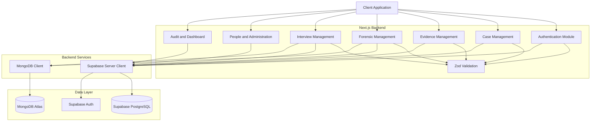
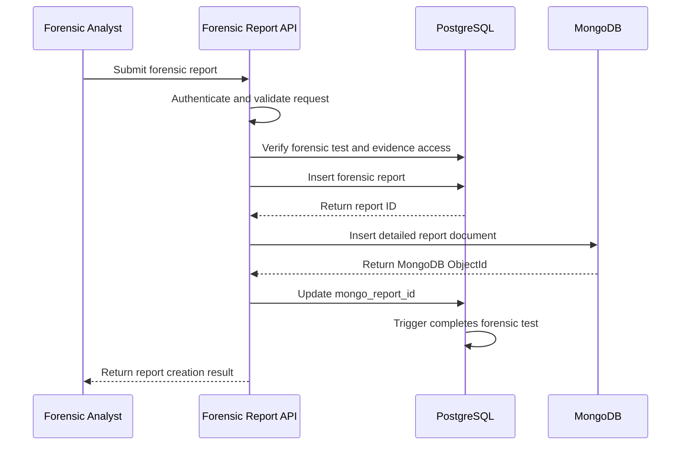
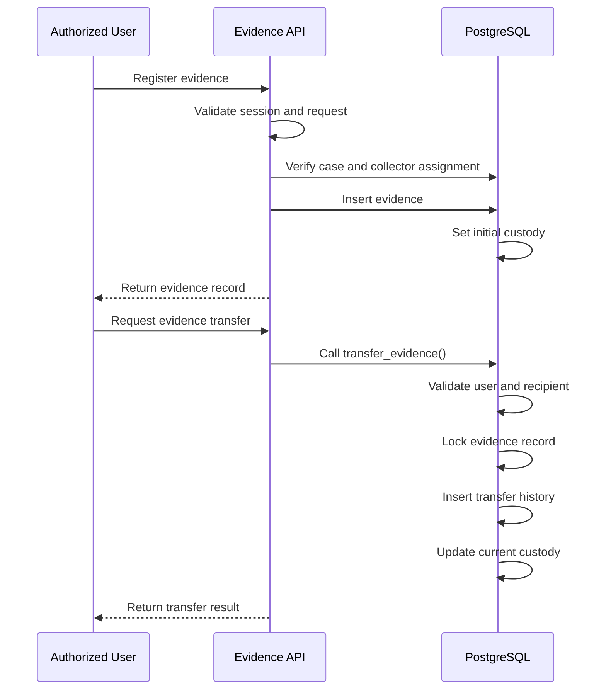

# CaseVault – Backend Architecture

## 1. Architecture Overview

CaseVault follows a modular backend architecture built using Next.js Route Handlers and TypeScript.

The backend communicates with two databases:
- Supabase PostgreSQL for structured relational data.
- MongoDB Atlas for document-oriented data.

Supabase Auth handles user authentication, while PostgreSQL Row Level Security (RLS) enforces access restrictions at the database level.

## 2. High-Level Architecture

## 3. Backend Modules

### 3.1 Authentication Module

Responsible for:
- Authenticating users.
- Maintaining authenticated sessions.
- Retrieving the current user's application profile.
- Identifying application roles.
- Supporting role-based access control.

Authentication is handled through Supabase Auth.

### 3.2 Case Management Module

Responsible for:
- Case creation and retrieval.
- Case updates.
- Case search.
- Case-crime associations.
- Case-person associations.
- Investigator assignments.

### 3.3 Evidence Management Module

Responsible for:
- Evidence registration.
- Evidence retrieval.
- Evidence metadata.
- Evidence custody information.
- Evidence transfer operations.
- Chain-of-custody history.

Evidence registration and transfer operations use database constraints and controlled server-side operations to protect custody information.

### 3.4 Forensic Management Module

Responsible for:
- Forensic test requests.
- Forensic test status management.
- Forensic report creation.
- Forensic report retrieval.
- Linking PostgreSQL reports with MongoDB report documents.

The report workflow uses PostgreSQL for report records and MongoDB for detailed report information.

### 3.5 Interview Management Module

Responsible for:
- Interview creation.
- Interview retrieval.
- Interview updates.
- References to interview transcripts stored in MongoDB.

### 3.6 Administrative Module

Includes:
- People management.
- Crime management.
- Location management.
- Crime scene management.
- Investigator assignment management.

### 3.7 Audit and Dashboard Module

Responsible for:
- Retrieving audit logs.
- Providing dashboard summaries.
- Displaying pending forensic work.
- Displaying evidence custody information.
- Displaying investigator workload information.

## 4. Database Interaction

### PostgreSQL

PostgreSQL stores structured and relational data.

Examples:
- A case can be associated with multiple crimes.
- A case can involve multiple persons.
- Investigators can be assigned to cases.
- Evidence belongs to an investigation case.
- Forensic tests reference evidence.
- Forensic reports reference forensic tests.
- Evidence transfers maintain custody history.

### MongoDB

MongoDB stores document-oriented information that does not need to be represented entirely through relational columns.

Collections:
- `interview_transcripts`
- `forensic_reports`
- `evidence_metadata`
- `activity_logs`

## 5. Forensic Report Data Flow

The backend also contains cleanup logic for handling failures during the PostgreSQL–MongoDB linking workflow. Cross-database operations are not a single distributed transaction, so failure handling is important.

## 6. Evidence Custody Data Flow

## 7. Security Architecture

The backend uses multiple layers of security:

1. Supabase Auth verifies the user session.
2. API handlers validate incoming request data.
3. Application role checks restrict sensitive operations.
4. PostgreSQL RLS enforces row-level access.
5. Database functions implement controlled operations.
6. Triggers enforce database-level integrity rules.
7. Audit triggers record database modifications.

## 8. Design Considerations

- Structured records are maintained in PostgreSQL.
- Document-oriented data is maintained in MongoDB.
- Database relationships are enforced using foreign keys.
- Access restrictions are enforced through RLS.
- Server-side validation is performed using Zod.
- MongoDB document references are maintained in PostgreSQL.
- Evidence custody changes are recorded as transfer history rather than unrestricted direct updates.

## 9. Deployment Architecture

The backend requires:
- A Next.js-compatible application runtime.
- A configured Supabase project.
- A PostgreSQL database with the required schema, policies, functions, and triggers.
- A MongoDB Atlas deployment.
- Secure environment variable configuration.

Deployment-specific configuration should be documented when the hosting environment is selected.