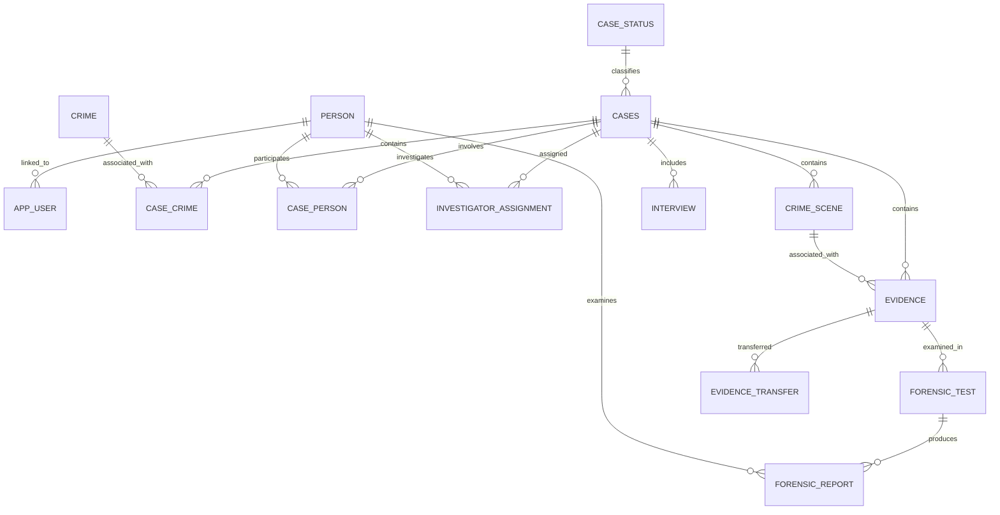

# CaseVault – Database Schema

## 1. Database Overview

CaseVault uses a hybrid database architecture consisting of:

1. **Supabase PostgreSQL** – relational database for structured application records.
2. **MongoDB Atlas** – document database for transcripts, forensic report details, metadata, and activity documents.

PostgreSQL maintains the primary relational records. MongoDB stores associated document-oriented information.

## 2. PostgreSQL Tables

The PostgreSQL database contains 16 primary tables.

| Table | Purpose |
|---|---|
| `location` | Stores location information. |
| `case_status` | Stores available case status values. |
| `crime` | Stores crime classifications and descriptions. |
| `person` | Stores information about persons involved in cases. |
| `app_user` | Maps authenticated Supabase users to application roles and persons. |
| `cases` | Stores investigation case records. |
| `case_crime` | Associates crimes with cases. |
| `crime_scene` | Stores crime scene information. |
| `case_person` | Associates persons with cases. |
| `investigator_assignment` | Stores investigator-to-case assignments. |
| `interview` | Stores structured interview records. |
| `evidence` | Stores evidence identification and custody information. |
| `forensic_test` | Stores forensic examination requests and statuses. |
| `forensic_report` | Stores structured forensic report records. |
| `evidence_transfer` | Stores evidence custody transfer history. |
| `audit_log` | Stores database change history. |

## 3. Key Relationships

The main relational relationships are:

- `app_user` references `person` to associate an authenticated user with an application person record.
- `cases` references case status and relevant location information.
- `case_crime` connects cases and crimes.
- `case_person` connects cases and persons.
- `investigator_assignment` connects investigators with cases.
- `crime_scene` is associated with an investigation case.
- `evidence` references a case and can reference a crime scene and locations.
- `forensic_test` references evidence.
- `forensic_report` references a forensic test and an examiner.
- `evidence_transfer` references evidence and records custody changes.
- `interview` stores structured interview information and its MongoDB transcript reference.

## 4. Simplified Entity Relationship Diagram

This is a simplified relationship diagram. It does not represent every foreign key, optional relationship, or database constraint.

## 5. Evidence Table

The `evidence` table stores information about collected evidence.

Important fields include:
- `evidence_id`
- `case_id`
- `crime_scene_id`
- `evidence_code`
- `description`
- `evidence_type`
- `condition_status`
- `date_collected`
- `collected_by`
- `location_found_id`
- `current_holder_id`
- `current_location_id`
- `sealed`
- `notes`

The current holder and current location represent the latest custody state. The evidence transfer history is maintained separately.

## 6. Forensic Test Table

The `forensic_test` table stores examination requests.

Important fields:
- `test_id`
- `evidence_id`
- `test_type`
- `requested_by`
- `request_date`
- `priority`
- `status`
- `notes`

Supported priority values:
- `low`
- `medium`
- `high`
- `urgent`

Supported status values:
- `requested`
- `in_progress`
- `completed`
- `cancelled`

A database trigger prevents a test from being marked completed without an associated forensic report. Completed tests cannot be reopened through the normal status update workflow.

## 7. Forensic Report Table

The `forensic_report` table stores the relational report record.

Important fields:
- `report_id`
- `test_id`
- `conclusion`
- `examiner_id`
- `report_date`
- `summary`
- `notes`
- `mongo_report_id`

The `mongo_report_id` field stores the MongoDB ObjectId reference for the corresponding detailed report document.

## 8. Evidence Transfer Table

The `evidence_transfer` table maintains evidence movement history.

It records transfer information, including:
- Evidence reference.
- Previous custodian.
- New custodian.
- Previous and new location information, where applicable.
- Transfer details and timestamp.

Transfers are performed through the database function `transfer_evidence()` rather than direct insertion through the authenticated API role.

Transfer records are protected against direct updates and deletions by a database trigger.

## 9. MongoDB Collections

| Collection | Purpose |
|---|---|
| `interview_transcripts` | Stores interview transcript documents. |
| `forensic_reports` | Stores detailed forensic report documents. |
| `evidence_metadata` | Stores document-oriented evidence metadata. |
| `activity_logs` | Stores activity log documents. |

### Forensic Report Document

A forensic report document contains information such as:
- PostgreSQL report ID.
- Forensic test ID.
- Evidence ID.
- Case ID.
- Examiner ID.
- Report type.
- Confidence value.
- Detailed report information.
- Findings.
- Creation timestamp.

The relational report record and its MongoDB document are linked through the MongoDB ObjectId reference stored in PostgreSQL.

## 10. Database Views

The backend uses the following PostgreSQL views:

| View | Purpose |
|---|---|
| `v_case_summary` | Provides case summary information. |
| `v_pending_forensics` | Provides pending forensic work information. |
| `v_evidence_current_custody` | Provides current evidence custody information. |
| `v_investigator_workload` | Provides investigator workload information. |

These views support dashboard and reporting functionality.

## 11. Database Functions

Important database functions include:

| Function | Purpose |
|---|---|
| `current_app_role()` | Retrieves the current authenticated user's application role. |
| `current_person_id()` | Retrieves the active user's associated person ID. |
| `is_assigned_to_case()` | Checks investigator case assignment. |
| `can_access_evidence()` | Checks evidence access according to the application role and case assignment. |
| `transfer_evidence()` | Performs a controlled evidence custody transfer. |
| `get_chain_of_custody()` | Retrieves evidence custody history. |
| `search_cases()` | Supports case search. |
| `health_check()` | Provides a PostgreSQL health check. |
| `cleanup_unlinked_forensic_report()` | Supports cleanup of an unlinked PostgreSQL forensic report. |

## 12. Database Triggers

Database triggers are used for:
- Audit logging.
- Evidence default custody initialization.
- Sealed evidence modification protection.
- Case status validation.
- Interview participant validation.
- Evidence transfer immutability.
- Automatic forensic test completion when a report is linked.
- Forensic test status validation.

## 13. Data Integrity

The database uses:
- Primary keys.
- Foreign keys.
- Check constraints.
- Row Level Security.
- Database functions.
- Triggers.

These mechanisms help maintain relational consistency and protect important investigation and evidence records.